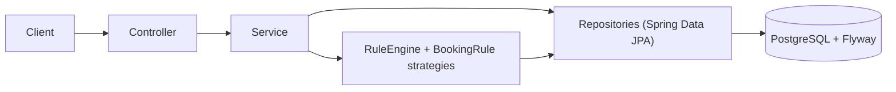

# Smart Booking Eligibility & Policy Rule Engine

A Spring Boot REST API for the **MoveInSync Backend Hiring Assessment 2026 — Case Study 1**.
When an employee books an office cab or shuttle, the system runs the request through a
stack of configurable company policies — shift window, seat quota, booking cut-off,
night-time women-safety, duplicates — and returns exactly one decision:
`ALLOW`, `DENY`, or `NEEDS_APPROVAL`, with the exact machine-readable reason codes and
a per-rule explanation of what ran and why.

## Table of contents

- [Overview](#overview)
- [Key features](#key-features)
- [Technology stack](#technology-stack)
- [Architecture and design](#architecture-and-design)
- [Rule-engine behavior](#rule-engine-behavior)
- [Data model](#data-model)
- [Prerequisites](#prerequisites)
- [Configuration and environment variables](#configuration-and-environment-variables)
- [Installation and local setup](#installation-and-local-setup)
- [Running the application](#running-the-application)
- [API documentation](#api-documentation)
- [Example booking evaluations](#example-booking-evaluations)
- [Testing](#testing)
- [Concurrency and transaction integrity](#concurrency-and-transaction-integrity)
- [Security and error handling](#security-and-error-handling)
- [Performance and complexity](#performance-and-complexity)
- [Observability, caching, and failure recovery](#observability-caching-and-failure-recovery)
- [Design decisions and trade-offs](#design-decisions-and-trade-offs)
- [Assumptions and limitations](#assumptions-and-limitations)
- [Future improvements](#future-improvements)
- [Demo and submission checklist](#demo-and-submission-checklist)

## Overview

Booking an office cab looks like one yes/no question, but it is really a stack of
policies: is the trip inside the employee's shift, are seats left in the cost centre,
was it booked early enough, does the night-safety rule apply, is it a duplicate?
Different clients switch different rules on with different priorities.

This application is the engine that answers that question. It loads the enabled,
applicable policy rows from PostgreSQL, evaluates each one through a small Strategy
object, and returns one decision plus the full explanation — which rules ran, in what
order, and why each passed, failed, or was skipped. Policy changes take effect on the
next evaluation with no code change and no restart. Seat reservations are claimed with
an atomic conditional update inside the same transaction that persists the booking, so
two employees racing for the last seat cannot both win.

## Key features

- **Five policy rules**, each a stateless `BookingRule` strategy: `SHIFT_WINDOW`,
  `COST_CENTRE_QUOTA`, `BOOKING_CUTOFF`, `NIGHT_SAFETY`, `DUPLICATE_BOOKING`.
- **Deterministic decisions**: same request + same policy rows + same DB state always
  yields the same verdict. Ordering is `(priority, ruleType, id)`.
- **Explicit precedence**: a failing hard-deny rule forces `DENY` regardless of
  priority; otherwise a failing soft rule (`hardDeny=false`) yields `NEEDS_APPROVAL`;
  otherwise `ALLOW`.
- **Explainability**: `POST /api/v1/bookings/evaluate?explain=true` returns the ordered
  `ruleResults`; every persisted booking stores its evaluation snapshot, retrievable
  via `GET /api/v1/bookings/{id}/explanation` even after policies change.
- **Advisory evaluation**: evaluating never touches quota or bookings.
- **Atomic quota**: `ALLOW` bookings reserve one seat with a conditional
  `UPDATE … WHERE reserved_seats < capacity` in the same transaction as the insert.
- **Idempotent cancellation**: releases exactly one seat; double-cancel is harmless and
  never drives the count negative.
- **Approval flow**: `NEEDS_APPROVAL` bookings wait as `PENDING_APPROVAL` (holding no
  seat); approving re-evaluates current policies, reserves atomically, and confirms —
  or refuses with a clear conflict. Rejection is a distinct terminal status.
- **Hot policy configuration**: list/create/update/enable/disable/reorder/delete via
  API; effective immediately.
- **JWT auth with three roles** (`EMPLOYEE`, `ADMIN`, `APPROVER`), BCrypt passwords,
  server-side ownership checks derived from the principal.
- **Consistent errors**: one `ApiError` schema, Bean Validation, request-id correlation,
  safe generic 500s.
- **Flyway-owned schema** (Hibernate validates only), real-PostgreSQL integration tests
  including the concurrent last-seat race.

## Technology stack

| Layer | Technology | Version |
|---|---|---|
| Language | Java | 21 |
| Framework | Spring Boot (`spring-boot-starter-parent`) | 4.1.1 |
| Build | Maven + Maven Wrapper (`mvnw` / `mvnw.cmd`) | wrapper-pinned |
| Web | Spring Web MVC (`spring-boot-starter-webmvc`) | Boot-managed |
| Persistence | Spring Data JPA + Hibernate | Boot-managed |
| Validation | Bean Validation (`spring-boot-starter-validation`) | Boot-managed |
| Security | Spring Security + jjwt (`jjwt-api/impl/jackson`) | Boot-managed / 0.12.6 |
| Database | PostgreSQL (+ `postgresql` JDBC driver) | 16 (dev/test) |
| Migrations | Flyway (`spring-boot-starter-flyway`, `flyway-database-postgresql`) | Boot-managed |
| Observability | Spring Boot Actuator + Micrometer | Boot-managed |
| Testing | JUnit 5, Mockito, AssertJ, Spring Boot test starters, Testcontainers (`testcontainers-junit-jupiter`, `testcontainers-postgresql`, `postgres:16-alpine`) | Boot-managed / TC 2.x |
| Manual demo UI | Static HTML/JS in `testing/` (zero-build) | — |

Not used (deliberately): no Dockerfiles/Compose files, no Swagger/OpenAPI, no caching
framework, no message broker, no expression language. See
[trade-offs](#design-decisions-and-trade-offs).

## Architecture and design

Request flow:



Layer responsibilities:

- **Controller** (`controller/`): HTTP mapping, DTO validation, status codes. No business
  logic. Six controllers: `Auth`, `Employee`, `Booking`, `Policy`, `Quota`, `Approval`.
- **Service** (`service/`): business logic and transactions. `BookingService` owns the
  evaluate → reserve → persist flow; `ApprovalService` owns review; `PolicyService`
  validates type-specific parameters; `AuthService`, `EmployeeService`, `QuotaService`
  own their domains; `AdminBootstrap` seeds dev logins when explicitly enabled.
- **Rule engine** (`service/rule/`): `RuleEngine` loads enabled, applicable
  `PolicyRule` rows, sorts them, and runs each through its `BookingRule` strategy with
  a `RuleContext`. Rules are read-only by contract — evaluation is advisory.
- **Repository** (`repository/`): Spring Data interfaces plus the two conditional-update
  quota statements and the pessimistic-lock booking lookup. Entities (`entity/`) never
  cross the API boundary — controllers speak DTO records (`dto/`) only.
- **Security** (`security/`, `config/SecurityConfig.java`): stateless JWT filter,
  role matrix, deny-by-default, request-id filter.
- **Shared config** (`config/ClockConfig.java`): one injectable `Clock` and company
  `ZoneId`, so cutoff tests use fixed time instead of wall-clock sleeps.

Design points a junior developer should be able to explain: rules are first-class
database rows interpreted by Strategy objects (not nested `if`s); precedence is three
lines of code in `RuleEngine.decide` plus tests; the database — not Java — serializes
the last seat (conditional update + partial unique index); policy reads are never
cached, so edits apply instantly.

```text
com.moveinsync.smart_booking_engine/
├── controller/   Auth, Employee, Booking, Policy, Quota, Approval
├── dto/          request/ + response/ + common/ (records, Bean Validation)
├── entity/       Employee, Booking, CostCentreQuota, PolicyRule, AppUser
├── enums/        Decision, BookingStatus, BookingDirection, RuleType, RuleOutcome,
│                 ReasonCode, Gender, Role, RoutePosition
├── exception/    ApiError, GlobalExceptionHandler, typed 4xx exceptions
├── repository/   Spring Data JPA + conditional-update quota methods
├── security/     JWT filter/service, user details, request-id filter
├── service/      Auth, Employee, Policy, Quota, Booking, Approval, AdminBootstrap,
│                 BookingSpecifications
│   └── rule/     BookingRule strategy, RuleContext, RuleResult, RuleEngine + 5 rules
└── config/       SecurityConfig, CorsConfig, ClockConfig
```

## Rule-engine behavior

### Evaluation algorithm

1. Load enabled rules (`findEnabledOrdered`), keep rows whose scope matches the
   employee (`businessUnit == null` matches every unit; `costCentreCode == null`
   matches every cost centre within it), sort by **priority, then rule-type name,
   then row id**.
2. Run **every** applicable rule (no short-circuit — the explanation must show the
   whole stack). A policy row with no registered strategy implementation fails closed
   as `INVALID_RULE_PARAMETERS` instead of crashing.
3. Combine: any failing hard-deny → `DENY`; else any failing soft rule → 
...[truncated 20887 chars]